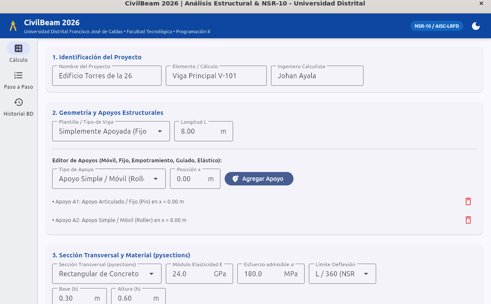
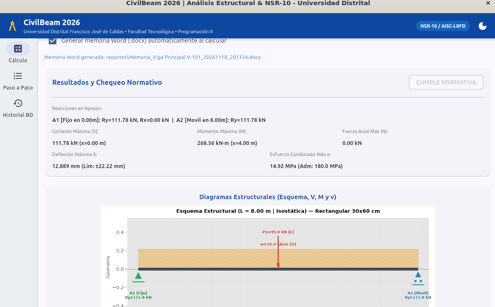
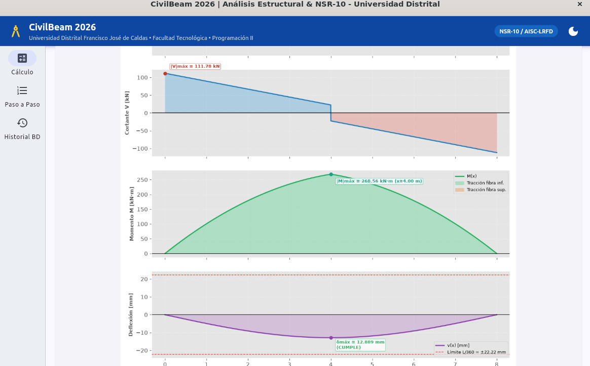
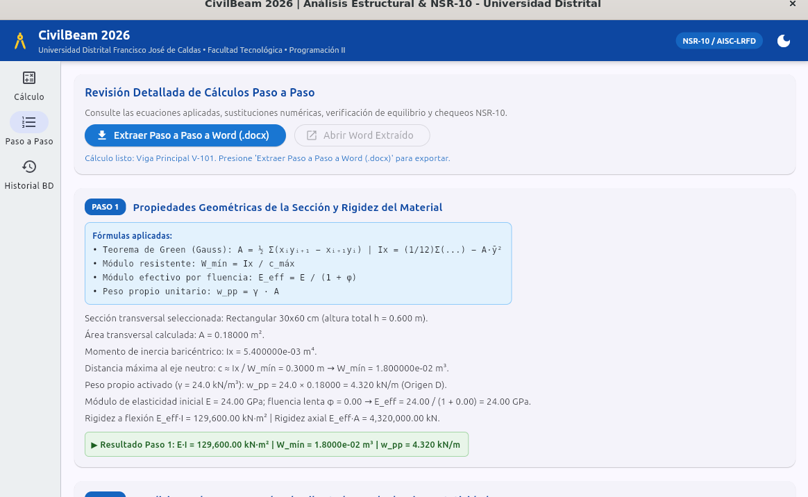

# CivilBeam 2026

### Análisis estructural de vigas mediante el Método de Elementos Finitos 1D

Aplicación de escritorio desarrollada en **Python y Flet Material 3** para analizar vigas isostáticas, hiperestáticas y sobre apoyos elásticos. Integra un núcleo numérico desacoplado de la interfaz gráfica, consulta del procedimiento de cálculo paso a paso y generación de memorias en Microsoft Word (`.docx`).

> Proyecto académico desarrollado en **Programación II — Grupo 18, semestre 2026-III**, Universidad Distrital Francisco José de Caldas, Facultad Tecnológica.

---

## Contenido

- [Descripción general](#descripción-general)
- [Funcionalidades](#funcionalidades)
- [Tecnologías](#tecnologías)
- [Estructura del proyecto](#estructura-del-proyecto)
- [Fundamentos de cálculo](#fundamentos-de-cálculo)
- [Instalación](#instalación)
- [Ejecución](#ejecución)
- [Ejemplo de uso sin interfaz](#ejemplo-de-uso-sin-interfaz)
- [Pruebas](#pruebas)
- [Créditos y contribuciones](#créditos-y-contribuciones)

---

## Descripción general

**CivilBeam 2026** permite modelar y analizar vigas sometidas a diferentes condiciones de apoyo y acciones estructurales. El programa calcula la respuesta de la estructura y presenta resultados como fuerza axial \(N(x)\), cortante \(V(x)\), momento flector \(M(x)\), giro \(\theta(x)\) y desplazamiento vertical \(v(x)\).

El proyecto separa el motor de cálculo de la interfaz de usuario. Por esta razón, el módulo numérico puede utilizarse desde scripts o pruebas sin necesidad de iniciar Flet.

## Funcionalidades

| Módulo | Descripción |
|---|---|
| Análisis estructural | Solución de vigas isostáticas e hiperestáticas mediante FEM 1D. |
| Condiciones de apoyo | Apoyos móvil, fijo, empotrado, guiado y elástico traslacional/rotacional. |
| Casos de carga | Cargas puntuales, distribuidas uniformes, triangulares, trapezoidales y polinómicas; momentos concentrados y cargas horizontales. |
| Acciones adicionales | Peso propio automático, variación térmica, retracción y fluencia lenta. |
| Combinaciones | Combinaciones de servicio y `nsr_1` a `nsr_6`, asociadas a NSR-10 Título B. |
| Visualización | Diagramas de fuerza axial, cortante, momento y desplazamiento. |
| Cálculo explicado | Desglose del procedimiento con fórmulas y sustituciones numéricas. |
| Informes | Generación de memorias de cálculo en formato Word (`.docx`). |
| Historial | Almacenamiento local de proyectos y cálculos mediante SQLite. |

## Tecnologías

| Tecnología o biblioteca | Uso |
|---|---|
| Python | Lenguaje principal. |
| Flet Material 3 | Interfaz gráfica de escritorio. |
| NumPy y SciPy | Operaciones numéricas y soporte científico. |
| Matplotlib | Generación de gráficas y diagramas. |
| SQLite | Persistencia local de proyectos y cálculos. |
| `docxtpl` y `python-docx` | Generación de documentos Word. |
| pytest | Pruebas automatizadas. |

Las versiones de las dependencias se encuentran especificadas en `requirements.txt`.

## Estructura del proyecto

```text
CivilBeam-2026/
├── main.py                       # Punto de entrada de la aplicación
├── ejecutar_sin_interfaz.py      # Demostración del motor sin interfaz gráfica
├── ejecutar.bat                 # Lanzador para Windows
├── ejecutar.ps1                 # Lanzador alternativo para PowerShell
├── requirements.txt             # Dependencias del proyecto
├── README.md                     # Documentación
│
├── app/
│   ├── modelo.py                # Motor de análisis FEM 1D
│   ├── sections.py              # Motor geométrico poligonal
│   ├── secciones.py             # Adaptadores y tipos de sección
│   ├── paso_a_paso.py           # Desarrollo del cálculo y exportación
│   ├── reporte.py               # Generación de memorias Word
│   ├── graficas.py              # Diagramas y comparativas
│   ├── db.py                    # Persistencia SQLite
│   └── ui/                      # Interfaz gráfica
│       ├── calculo_view.py
│       ├── paso_a_paso_view.py
│       └── historial_view.py
│
├── plantillas/
│   └── memoria.docx             # Plantilla de memoria de cálculo
├── herramientas/
│   └── crear_plantilla.py       # Generación de la plantilla Word
├── ejemplos/
│   └── memoria_ejemplo.docx     # Ejemplo de memoria generada
└── tests/
    └── test_modelo.py           # Pruebas automatizadas
```

## Fundamentos de cálculo

### Propiedades geométricas de la sección

Las propiedades geométricas de las secciones poligonales se calculan mediante el Teorema de Green o fórmula de Gauss. Para el área:

\[
A = \frac{1}{2}\sum_{i=0}^{n-1}(x_i y_{i+1}-x_{i+1}y_i)
\]

El módulo resistente se determina a partir del momento de inercia y la distancia máxima al eje neutro:

\[
W_{\min}=\frac{I_x}{c_{\max}}
\]

Cuando se activa el peso propio, este se obtiene a partir del peso específico del material y el área de la sección.

### Formulación por elementos finitos

La viga se discretiza mediante una malla adaptativa. Cada nodo contempla tres grados de libertad: desplazamiento axial \(u\), desplazamiento transversal \(v\) y giro \(\theta\).

- **Flexión de Euler-Bernoulli:** utiliza funciones cúbicas de Hermite.
- **Comportamiento axial:** se formula mediante elementos de barra unidimensionales.
- **Cargas distribuidas:** se integran mediante cuadratura de Gauss-Legendre de cuatro puntos.
- **Apoyos elásticos:** sus rigideces se incorporan al sistema global de ecuaciones.

La solución del sistema estructural se expresa como:

\[
[K]\{U\}=\{F\}
\]

### Acciones térmicas y fluencia

Para considerar la fluencia lenta, el módulo de elasticidad efectivo se ajusta mediante:

\[
E_{\mathrm{eff}}=\frac{E}{1+\varphi}
\]

El modelo también contempla deformaciones iniciales asociadas a variaciones térmicas, retracción y fluencia lenta, de acuerdo con los parámetros definidos en el proyecto.

### Combinaciones y verificaciones

El programa contempla combinaciones de servicio y las combinaciones `nsr_1` a `nsr_6`, relacionadas con NSR-10, Título B. También presenta verificaciones de esfuerzo y desplazamiento según los parámetros definidos para el análisis.

> **Nota:** los resultados del programa deben interpretarse y verificarse dentro del alcance del modelo y de los criterios normativos aplicables al proyecto.

## Instalación

### Requisitos

- Python 3.10 o superior.
- Git.
- Conexión a Internet para instalar las dependencias.

### 1. Clonar el repositorio

```bash
git clone https://github.com/Johan17Ayala/CivilBeam-2026.git
cd CivilBeam-2026
```

### 2. Crear un entorno virtual

**Windows (PowerShell):**

```powershell
python -m venv .venv
```

**Linux o macOS:**

```bash
python3 -m venv .venv
```

### 3. Activar el entorno virtual

**Windows (PowerShell):**

```powershell
.\.venv\Scripts\Activate.ps1
```

**Windows (CMD):**

```bat
.venv\Scripts\activate.bat
```

**Linux o macOS:**

```bash
source .venv/bin/activate
```

### 4. Instalar las dependencias

```bash
pip install -r requirements.txt
```

## Ejecución

Para iniciar la aplicación gráfica:

```bash
python main.py
```

En Linux o macOS, si el comando `python` no está disponible, utiliza:

```bash
python3 main.py
```

En Windows también se puede utilizar el lanzador `ejecutar.bat`.

### Recorrido general de la aplicación

1. En la vista **Cálculo**, define la longitud, la sección transversal y las condiciones de apoyo.
2. Agrega las cargas y especifica su origen.
3. Ejecuta el análisis.
4. Consulta los diagramas de respuesta estructural.
5. Accede a **Paso a Paso** para revisar el procedimiento y exportarlo a Word.
6. Utiliza **Historial** para consultar cálculos almacenados, reabrir proyectos y comparar diagramas.

## Ejemplo de uso sin interfaz

El motor de análisis puede utilizarse desde Python sin iniciar la aplicación gráfica. El repositorio incluye `ejecutar_sin_interfaz.py` como demostración.

También es posible importar las funciones principales:

```python
from app.modelo import analizar_viga_desde_diccionario
from app.paso_a_paso import generar_pasos_calculo, generar_word_paso_a_paso

config = {
    "longitud": 8.0,
    "tipo_viga": "empotrada_movil",
    "apoyos_detalle": [
        {"tipo": "empotrado", "x": 0.0},
        {"tipo": "movil", "x": 8.0},
    ],
    "E_GPa": 24.0,
    "sigma_adm": 180.0,
    "limite_k": 360,
    "incluir_peso_propio": True,
    "combinacion": "nsr_2",
    "seccion": {
        "tipo": "rectangular",
        "parametros": {"base": 0.30, "altura": 0.60},
    },
    "cargas": [
        {
            "tipo": "distribuida",
            "w1": 18.0,
            "w2": 18.0,
            "x1": 0.0,
            "x2": 8.0,
            "origen": "D",
        },
        {
            "tipo": "puntual",
            "P": 35.0,
            "Px": 10.0,
            "x": 4.0,
            "origen": "L",
        },
    ],
}

viga, resultado = analizar_viga_desde_diccionario(config)
pasos = generar_pasos_calculo(viga, resultado)

print(f"|V| máx = {resultado.V_abs_max:.2f} kN")
print(f"|M| máx = {resultado.M_abs_max:.2f} kN·m")

generar_word_paso_a_paso(
    viga,
    resultado,
    "Proyecto Demo",
    "Viga V-101",
    "Ing. Civil",
)
```

## Pruebas

El proyecto incluye pruebas automatizadas en `tests/`.

Para ejecutarlas:

```bash
python -m pytest -v
```

En Linux o macOS también puede utilizarse:

```bash
python3 -m pytest -v
```

La documentación original del proyecto indica una suite de 11 pruebas. El resultado debe comprobarse ejecutando las pruebas en el entorno local.

## Créditos y contribuciones

**Universidad Distrital Francisco José de Caldas**  
Facultad Tecnológica — Proyecto Curricular de Ingeniería Civil  
Programación II, Grupo 18, semestre 2026-III.

- **Propietario del repositorio:** [@Johan17Ayala](https://github.com/Johan17Ayala) — Johan Ayala.
- **Colaborador:** [@herrerita1414](https://github.com/herrerita1414).

### Atribución de proyectos base

El módulo geométrico `app/sections.py` se basa en el proyecto [pymas](https://github.com/rvcristiand/pymas), desarrollado por **Cristian Danilo Ramírez Vargas** ([@rvcristiand](https://github.com/rvcristiand)).

Este componente utiliza el Teorema de Green / Gauss para obtener propiedades mecánicas de secciones poligonales y se integra con adaptaciones en `app/secciones.py`. El proyecto base se distribuye bajo licencia GNU GPL v3.

### Cómo contribuir

1. Crea una rama descriptiva para tu aporte.
2. Realiza cambios procurando mantener la separación entre el núcleo numérico y la interfaz gráfica.
3. Ejecuta las pruebas con `python -m pytest -v`.
4. Registra los cambios mediante commits claros y descriptivos.
5. Envía tus contribuciones mediante un Pull Request.

---

<p align="center">
  <strong>CivilBeam 2026</strong><br>
  Herramienta académica para el análisis y documentación de vigas.
</p>
## Capturas de la aplicación

A continuación se presentan algunas vistas de CivilBeam 2026 durante el análisis de una viga:

### Configuración del modelo
En esta sección se ingresan los datos del proyecto, la geometría de la viga, los apoyos y las propiedades de la sección transversal.



### Resultados y chequeo normativo
La aplicación presenta las reacciones en los apoyos, los valores máximos de cortante y momento, la deflexión y el chequeo de esfuerzos.



### Diagramas estructurales
Se muestran el esquema estructural y los diagramas de cortante, momento flector y deformación.



### Cálculo paso a paso
Se presenta el desarrollo de los cálculos, con las fórmulas aplicadas, sustituciones numéricas y resultados de cada etapa. También permite exportar el desarrollo a Word.


